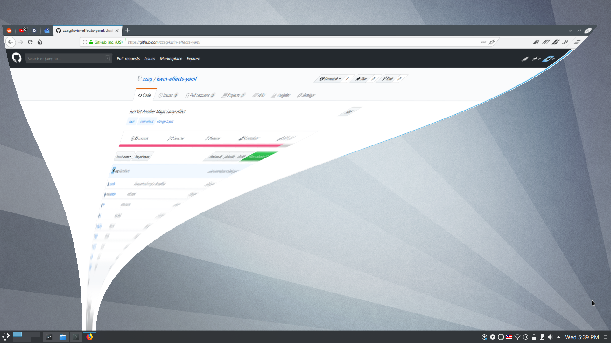

# Yet Another Magic Lamp



[Demo](https://www.youtube.com/watch?v=BR4bUwFZDS8)

Yet Another Magic Lamp is a window minimization effect for KWin. Whenever a window
is minimized, it gets sucked down into the dock/panel with a curvy animation.
Compared to the built-in Magic Lamp effect, this one has smoother curves,
better multi-screen panel handling, and more configuration options.

## Tested Platforms

This port targets **KWin 6 (Plasma 6)** and has been tested only on:

| Distro | KWin version | Status |
|--------|-------------|--------|
| Arch Linux / Manjaro | 6.6.5 | Working |

Other distributions or KWin versions may work but have not been verified.
The KWin 5 version is available on the `Plasma/5.23` branch of the original
[upstream repository](https://github.com/zzag/kwin-effects-yet-another-magic-lamp).

## Known Issues

- Some third-party Aurorae window decoration themes (e.g. Orchis) may show a
ghost window outline during the animation. Use the default **Breeze** theme as a
workaround.

## Dependencies

| Package | Arch Linux |
|---------|-----------|
| C++20 compiler (GCC 16+) | `gcc` |
| CMake | `cmake` |
| Extra CMake Modules | `extra-cmake-modules` |
| Qt 6 | `qt6-base` |
| KDE Frameworks 6 (Config, CoreAddons, WindowSystem, ConfigWidgets, KCMUtils) | `kconfig` `kcoreaddons` `kwindowsystem` `kconfigwidgets` `kcmutils` |
| KWin 6 development headers | `kwin` |
| libepoxy | `libepoxy` |

## Build from Source

```sh
git clone https://github.com/zzag/kwin-effects-yet-another-magic-lamp.git
cd kwin-effects-yet-another-magic-lamp

mkdir -p build && cd build
cmake .. -DCMAKE_BUILD_TYPE=Release -DCMAKE_INSTALL_PREFIX=/usr
make -j$(nproc)
sudo make install
```

The effect plugin will be installed to `/usr/lib/qt6/plugins/kwin/effects/plugins/`.

## Enable the Effect

Go to **System Settings → Desktop Effects**, search for "Yet Another Magic Lamp",
enable it, and click Apply.

> **Note:** This effect belongs to the "minimize" exclusive group. If the
> built-in "Magic Lamp" effect is enabled, disable it first.
